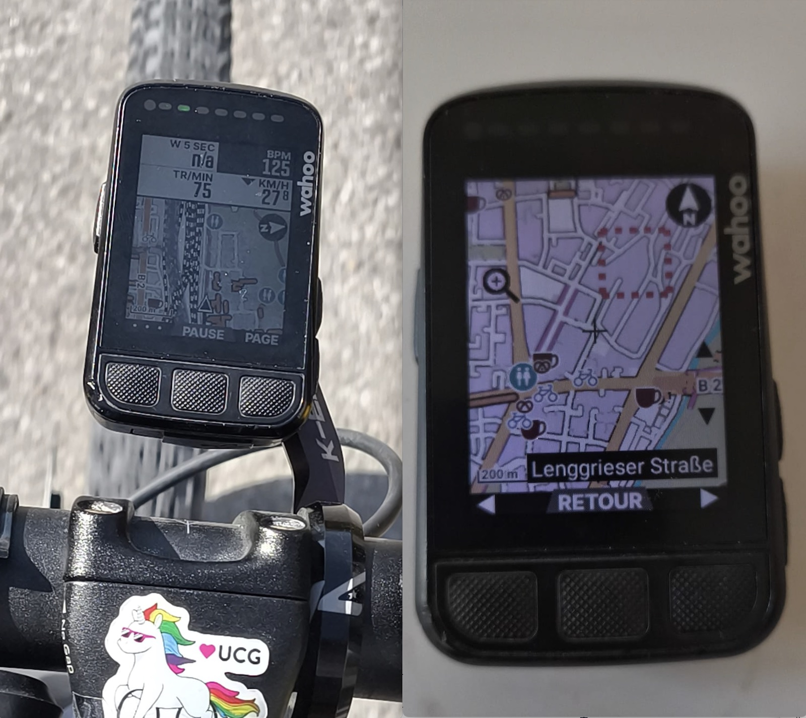
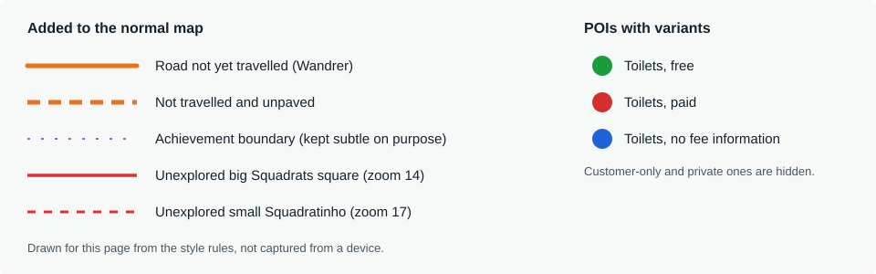
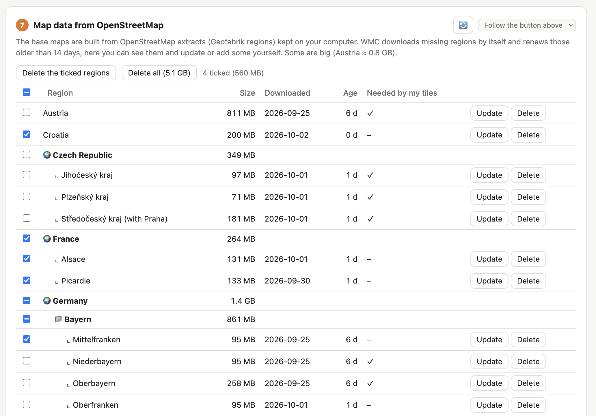
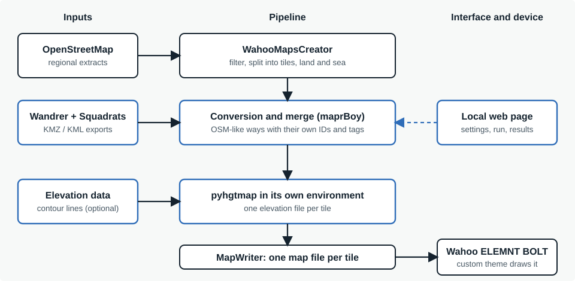

# maprBoy 


maprBoy makes custom OpenStreetMap maps for bike computers and watches, with the points of interest you choose,
your **[Wandrer](https://wandrer.earth)** roads (the ones you have not ridden yet, in orange) and your
**[Squadrats](https://squadrats.com)** squares (the ones not explored yet, outlined in red). Everything is set from a
local web page.





## Devices

| Device | Status | Details |
|---|---|---|
| Wahoo ELEMNT BOLT v2 | in daily use | full maps, tile by tile ([WahooMapsCreator](https://github.com/treee111/wahooMapsCreator)) |
| Wahoo ELEMNT ROAM v1 | tested once (borrowed device) | same maps, `.map.gz` tiles |
| Garmin Forerunner 955, Edge 830, Edge 530 | tested (the base map: on the Forerunner 955) | a map over the Garmin map, and an optional OpenStreetMap base map |
| Hammerhead Karoo 2 | tested on a borrowed device | a map drawn over Hammerhead's maps |

What was learned on each device: [docs/DEVICES.md](docs/DEVICES.md) and, for Garmin, [docs/GARMIN.md](docs/GARMIN.md).

## Install (Mac)
In the Terminal (Applications > Utilities), paste:
```
bash -c "$(curl -fsSL https://raw.githubusercontent.com/florentchevallier/maprboy/main/install_macos_linux.sh)"
```
It asks where to install (default `~/maprBoy`) and puts everything in that folder:
- `maprBoy-app/`: the code, micromamba with its environment (Python, GDAL, osmium, Java), Osmosis, mkgmap, adb,
  pyhgtmap (contour lines), the settings (`state/`), `maprBoy.command` and `uninstall.command`;
- `maprBoy-data/`: the Wandrer and Squadrats exports, the OSM data and the maps made (first installation only).

Outside it: `maprBoy.command` on the Desktop (double-click: the page opens; keep the Terminal window open while
you use it), the link `~/wahooMapsCreatorData` to `maprBoy-data/OSM_data`, which WMC needs, and the MapWriter plugin
of Osmosis in `~/.openstreetmap/osmosis/plugins/`. The first
installation downloads about 2 GB. libmtp (copy to a Garmin watch) is installed with Homebrew when it is there and
you ask for it. Running the installer again updates the code; settings already made are kept. To uninstall,
double-click `maprBoy-app/uninstall.command`: it asks whether your data should be deleted too.
Run from a copy of the repository (`bash install_macos_linux.sh`), it installs that copy instead of the code on GitHub.

The installer was tested on an Intel Mac with macOS 10.14 and on an Apple Silicon Mac.

## Install (Linux)
In a terminal, paste:
```
bash -c "$(wget -qO- https://raw.githubusercontent.com/florentchevallier/maprboy/main/install_macos_linux.sh)"
```
The same installer as on a Mac, for 64-bit Linux (Intel/AMD or ARM); it needs `unzip` (on Ubuntu or Debian:
`sudo apt install unzip`). Same layout, with `maprBoy.sh` and `uninstall.sh` in `maprBoy-app`, and a maprBoy
launcher in the applications menu and on the Desktop (it opens a terminal; on Ubuntu, the Desktop one may first need
a right-click and "Allow Launching"). Copying to a Garmin watch needs `sudo apt install mtp-tools`. To uninstall:
`bash maprBoy-app/uninstall.sh`. Tested on Ubuntu 26.04 (a virtual machine).

Other systems: install by hand (see "Installation (by hand, for development)" below).

## Install (Windows)
In PowerShell (Start menu, type PowerShell), paste:
```
irm https://raw.githubusercontent.com/florentchevallier/maprboy/main/install_windows.ps1 -OutFile "$env:TEMP\install_windows.ps1"; powershell -ExecutionPolicy Bypass -File "$env:TEMP\install_windows.ps1"
```
The installer is downloaded first, then run: Microsoft Defender blocked the shorter `irm ... | iex` form
(November 2026, "Trojan:Win32/Commando.C!ml", a heuristic detection); the same script run as a file passes.
Same layout as on a Mac (`maprBoy-app`, `maprBoy-data`, default `%USERPROFILE%\maprBoy`), with a maprBoy shortcut on the
Desktop and `maprBoy-app\uninstall.bat`. On Windows maprBoy runs without a window: the shortcut starts it in the
background and opens the page; "Quit maprBoy" in the settings of the page stops it (its messages go to
`maprBoy-app\state\server.log`). `%USERPROFILE%\wahooMapsCreatorData` becomes a directory junction to
`maprBoy-data\OSM_data`. Copying from the page works for every device: a Wahoo and a Karoo with adb, a Garmin
Edge as a drive, a Garmin watch through File Explorer (MTP). Windows asks once whether adb may use the network
(firewall): the copies worked with that access refused. With contour lines, maprBoy downloads elevation data from
viewfinderpanoramas.org: an antivirus may show it as a connection to `maprBoy-app\env\python.exe` and ask whether
to allow it (seen with Panda Dome): it is that download.

The installer was tested on Windows 10 (a virtual machine) and Windows 11.

## Updates
The installers install the latest release published on GitHub (the main branch while there is none) and note
which one in `maprBoy-app/code/VERSION`. Once a day the page asks GitHub which release is the latest (nothing about
you is sent); when it is newer, a note at the top of the page offers to **Update**. Update stops the page, opens a
terminal window that runs the installer again for the same folder (settings and data are kept), then starts
maprBoy again with a new page. The check can be turned off, or done at once with "Check now", in the settings (⚙,
"maprBoy"). A copy installed before this existed has no `VERSION` file: run the installer once by hand. A copy run
from a clone of the repository is never offered updates (use git).

## Use
1. Start maprBoy (`maprBoy.command` on the Desktop): the page opens in your browser.
2. Choose your device at the top: Wahoo, Garmin or Karoo.
3. Drop your Wandrer exports (`.kmz`) and your Squadrats export (`.kml`) on the page.
4. Choose the area: zoom-8 tiles for a Wahoo, a rectangle drawn on the map for a Garmin or a Karoo (or the area of
   your exports, or OpenStreetMap regions).
5. Choose the points of interest, then press **Make the maps**. The OpenStreetMap data is downloaded the first time.
6. Step 2 copies the maps to the device plugged in by USB, or shows the files to copy by hand.



## How it works



The diagram shows the Wahoo maps. The Wandrer roads are not matched to OpenStreetMap roads: they are kept as their
own lines, with their own tags. Garmin and Karoo work the same way without WahooMapsCreator: osmium takes what is needed
from the OpenStreetMap extracts, then mkgmap makes the Garmin `.img` maps and the mapsforge MapWriter (with Osmosis)
the Karoo `.map` file. Contour lines are made for the Wahoo maps only.

## For developers
The sections below describe the command line, the code and the manual installation.

### Releases
Installed copies are offered a release when its tag is a higher version number than theirs. Tags follow
`vMAJOR.MINOR.PATCH`: `v1.0.1`, `v1.0.2`... for bug fixes, `v1.1.0`, `v1.2.0`... for new features (GitHub > Releases >
Draft a new release, a new tag on `main`, Release label "None": a published release becomes the latest one).
A pre-release (like `land-polygons`, which only holds a data file) is not offered. The installers themselves are
always taken from `main`, so a change to them reaches the next update even before a release.

### Code overview
- `wahoondrer/kmz.py`: reads and merges several exports with de-duplication (newest export wins, ordered by the timestamp inside the KML; an older road disappears only when the newer export redraws it).
- `wahoondrer/process.py`: keeps unvisited roads only within a radius of traveled roads (default 250 m; options to keep every unpaved or every paved road), merges chained segments (always), simplifies geometry.
- `scripts/build_tiles.py`: classic WMC tiles + Wandrer tiles, output folder with a copy guide for the Bolt.
- `wahoondrer/progress.py`: download progress bar (replaces WMC's silent download function) and "step n of N" counter; in the GUI they are sent as log lines starting with the character `\x01` (`P|text` bar, `S|n|total|label` step).
- `wahoondrer/squadrats.py`: rebuilds the explored squares from the Squadrats KML and outlines the unexplored ones in a band around them.

### Command line (Wahoo)
```
# 1. merge exports into one OSM file (standard library only)
python3 scripts/kmz_to_osm.py -o ~/wandrer.osm path/to/exports/*.kmz

# 1b. optional: add the Squadrats outlines (unexplored squares)
python3 scripts/kmz_to_osm.py -o ~/wandrer.osm path/to/exports/*.kmz \
    --squadrats path/to/squadrats.kml [--squadrats-levels big,small] [--squadrats-buffer 3] \
    [--squadrats-small-scope explored-big|band|both]

# 1c. Squadrats alone, without any Wandrer export: say on which z8 tiles to draw them
python3 scripts/kmz_to_osm.py -o ~/wandrer.osm --squadrats path/to/squadrats.kml --tiles 137/83,137/84

# 2. build the tiles (WMC importable, Java and osmium installed)
python3 scripts/build_tiles.py \
    --xy 135/88,135/89,136/88,136/89 --wandrer ~/wandrer.osm --plan
```
Remove `--plan` for the real run. See `docs/PIPELINE.md` for details.

## The page in detail
```bash
wahoondrer-env                     # or any environment where WMC is installed
python3 scripts/gui.py             # opens http://127.0.0.1:8765/ in your browser
```
The page checks that WMC and its libraries can be imported by the Python that runs it. If not (the usual cause:
the environment was not activated before starting the page), a red box at the top names the missing modules and the
buttons that start a build stay disabled; the same warning is printed in the terminal.
It also checks the versions: Python 3.10 or newer and WahooMapsCreator 4.4.0. An older WMC or Python stops the same way,
with the command to fix it; a newer WMC only shows a note (it may work, it was not tested).

1. **Folders**: press "Set up my folders" and pick a location; the page creates `Wandrer_exports`,
   `Squadrats_exports`, `Output`, `Work_files` and `OSM_data` there (or choose your own folders; "Open" shows
   a folder in your file manager). Drop your `.kmz` / `.kml` files on the page or into those folders.
   `OSM_data` holds the OpenStreetMap extracts: WMC always reads `~/wahooMapsCreatorData`, so that path
   becomes a symbolic link to `OSM_data` (created automatically if WMC has no data yet; otherwise the page
   offers to move the existing data, never without asking).
2. **Exports**: each export is listed with its date, type (bike, foot, combined), the town where you ride
   most in it (looked up online, can be switched off), what it contains (coloured tags) and its tiles. "Untick all" / "Tick all" switch every export at once.
   "Which exports to use" picks one type: bike, foot or combined; until you choose, the type of your newest
   export is used. The choice is kept for each device (e.g. bike for the Wahoo, foot for a Garmin watch).
   Pro mode adds "all types" (mix). Reading big files takes a while the first time
   (a progress bar is shown); results are cached. Files dropped on the page are copied into your Wandrer folder
   and named `wandrer-<date>-<town>-<type>.kmz` (date and type read inside the file; `-2`, `-3`... rather than
   replacing a file; a file already there is not copied again).
3. **Tiles**: click the map (zoom-8 tiles), or use the tiles of your exports. Buttons: zoom to your data, my location.
4. **Wandrer layer** / 5. **Squadrats layer**: options. The **Simple / Pro** switch (top right) shows more
   options and the numbers inside each export. Each section also has its own small selector (Follow the button /
   Simple / Pro), e.g. everything in Pro except the points of interest.
6. **Points of interest**: tick the kinds of places to draw (fuel, café, water, toilets, bakery, bike shop,
   railway, bike repair station, camp site, shelters: only huts, weather and picnic shelters, never bus stops) and choose from which zoom level. Pro adds the icon (library icons or a
   square / circle / triangle / diamond in red, blue, green, yellow, purple, orange, black or white), the size, and
   "add your own" by OSM tag (check the data first on taginfo / overpass-turbo). The default style of
   `config/poi-rules.json` is never modified: your choices live in `~/.wahoondrer/settings.json`, and "Back to the
   defaults" restores everything. A change needs the tiles rebuilt and the theme copied to the Bolt again.
7. **Map data from OpenStreetMap**: the regions WMC has downloaded (date, size, age); update or delete one,
   download the ones your tiles need, or add another region. A region Geofabrik no longer offers (old French
   regions such as Picardie) is reported and skipped; download its parent region instead. WMC renews regions
   older than 14 days by itself.
   The list is grouped by country (then by sub-region, e.g. Germany > Bayern > Oberfranken) with the size of each group.
   Tick several regions (or a whole country or group with the box in front of its name) and press "Delete the ticked regions" (or "Delete all") to free the disk in one go; WMC downloads again what a map needs.
8. **Make the maps**: "Check the plan" lists the tiles and OSM regions needed; "Generate maps" runs
   `kmz_to_osm.py` then `build_tiles.py` and shows the log. The run goes on if you close the page (it belongs to
   the terminal running `gui.py`): reopen the page to see the log again. The three buttons ("Check the plan", "Generate maps" and the red **STOP**) are in a column left of the log;
   STOP is greyed out unless a run is going, and cancels it (after a confirmation); the log ends with the total time. A "To know" box repeats the warnings
   (lines starting with `!`), e.g. tiles without Wandrer data.
   A tile that no OSM region covers (open sea) is left out and reported there; the other tiles are still built.
   When a run ends, a system notification says that the maps are ready (and how long it took) or which step failed,
   so you can do something else meanwhile; untick "Notify me when a run ends" to turn it off. On macOS the banner is
   shown under the name "Script Editor" (allow it in System Settings > Notifications); on Linux it needs
   `notify-send`; on Windows it is shown under the name "Windows PowerShell". When the log shows a known cause of failure (a module
   missing because the environment is not active, a full disk), a "Hint:" line says what to do.
   While it runs, a progress bar shows each OSM download (size, percentage, speed), and a "step n of N" bar
   follows the stages of the build (the stages themselves are run by WMC and have no finer percentage).
   Wandrer and Squadrats are independent: Squadrats alone need no Wandrer export, and the Wandrer exports are
   not even unzipped when none of them touches the chosen tiles.
   The output folder keeps one tile per coordinates: a run replaces only the tiles it rebuilds. Tiles with no
   Wandrer data are copied from the classic build into `wahoondrer_maps` too (marked "plain tile"), so that
   folder is the complete set for the Bolt. Below the log, "Files for the Bolt" lists the theme, the tiles of
   the last run, then the other tiles (see "Output folder" below).

Settings are remembered in `~/.wahoondrer/settings.json` (with the installer: `maprBoy-app/state/`), one set per
device (Wahoo, Garmin, Karoo) plus the shared ones (folders, Simple/Pro, online town lookup, Squadrats file), and a
reading cache in `cache.json` next to it (outside the repository). The page only listens on your own computer (127.0.0.1). The map background needs
an internet connection; without it, type the tiles in the box. Step 2 copies the maps to the device, or lists the
files to copy by hand (see also `README.txt` in the output folder).

## Contour lines (optional, experimental)
Tick **Add contour lines** in step 8 (Pro mode), or use `--contour` with `scripts/build_tiles.py`. The lines come
from the free Viewfinder Panoramas elevation data (3 arc-seconds: standard lines, not the finest SRTM 1 ones) and
need **no account**. maprBoy's theme draws them in thin grey/brown lines (100 m lines from zoom 12, 50 m from 13,
10 m from 14). Not tested on a Bolt yet.

Line spacing (Pro mode, or `--contour-spacing`): `10-50-100` (finest), `25-75-150` (default) or `30-90-180`
(lightest), as fine / medium / thick lines in metres. Medium and thick lines are multiples of the fine step, so
they always match an existing line; the theme draws thick lines from zoom 12, medium from 13, fine from 14.
Changing the spacing recomputes the contour lines of the tiles (files made before this setting count as 10-50-100).

Output folder: one tile per coordinates. A new run replaces only the tiles it rebuilds and keeps the others (to keep
several versions of a tile, with/without Wandrer or relief, copy them elsewhere yourself). The "Files for the Bolt"
list shows the theme, then the tiles of the last run (🌟 marks the ones just rebuilt), then the other tiles, each with
its date, nearest town and size (in Pro mode also the contour level it was built with: None / Fine / Medium / Coarse).
`last_run.json` and `tiles_info.json` in the output folder record the last run and what each tile contains.
In Pro mode the small map under the contour option also lets you click a tile to take it out or put it back.

"Only redo the Wandrer part" (Pro, or `--skip-classic`): skips the long classic phase and reuses the classic tiles of
the last full run. Before doing so the script checks that the tiles, their contour lines, the POI settings and the
downloaded OSM data are the same as in that run; if not, it says why and rebuilds everything (the message also
appears in the "To know" box). Use it when only the Wandrer data changed.

Per-tile spacing (Pro mode): tick "Choose the contour lines tile by tile" and a menu appears in the top-right corner
of each selected tile on the map: None / Fine / Medium / Coarse. Handy for light lines in high mountains and fine
ones on flat tiles. On the command line: `--contour-tile 136/88=none --contour-tile 136/89=30-90-180`. "None" keeps
the tile's elevation file aside (`*.osm.off`) so WMC ignores it; it comes back when you pick a spacing again.

One-time setup, in a terminal (it installs `pyhgtmap` in its own small environment in `~/.wahoondrer/`, so it
cannot disturb GDAL or shapely):

    python3 scripts/build_tiles.py --setup-contour

Why not WMC's own contour step? It calls `phyghtmap` 2.23, an old program that fails with current Python libraries.
maprBoy runs `pyhgtmap` (its maintained fork) itself with the same settings and hands the result to WMC.

The first run downloads the elevation data and computes the lines of every tile (slow); both are kept for the next
runs (an unfinished or empty contour file is detected and redone). Tiles become heavier: check `size_report.txt`.
With contour lines, the theme must be copied to the Bolt too (see `README.txt` in the output folder).

## Points of interest (details)
`config/poi-rules.json` is the catalogue and the default style (label, zoom, icon, size, `enabled`). The web page
offers every entry; `scripts/generate_poi_config.py` writes it into the tag-mapping XMLs, `tags-to-keep.json` and the
theme (`--check` tells whether they are up to date). With choices made in the page, `build_tiles.py --poi-rules FILE`
generates a private copy of the config and theme in `~/.wahoondrer/generated/` and builds with it, so repository
files stay untouched.

## Installation (by hand, for development)
maprBoy itself needs only Python 3 (standard library). `scripts/build_tiles.py` also needs
WMC and its tools: Java, osmium-tool, Osmosis and GDAL (`ogr2ogr` **and** the Python `osgeo`
module, from the same GDAL build).

Tested setup (clean install, 2026-09-30, macOS 13 Ventura, Intel):

| Component | Version | Source |
|---|---|---|
| WahooMapsCreator | 4.4.0 (`pip show wahoomc`) | pip (`requirements.txt`) |
| Python | 3.10.21 | conda-forge |
| GDAL (`ogr2ogr` + `osgeo`) | 3.6.4 | conda-forge |
| osmium-tool | 1.16.0 | conda-forge |
| shapely / geojson / requests | 2.0.2 / 3.3.0 / 2.34.2 | conda-forge |
| Java | Temurin 26.0.2.1 | any JRE that runs WMC |
| Osmosis | 0.49.2 | manual download, on PATH |

**Recommended: micromamba** (standalone binary, no Anaconda, no shell init):
```
mkdir -p ~/micromamba-bin && cd ~/micromamba-bin
curl -fsSL https://micro.mamba.pm/api/micromamba/osx-64/latest | tar -xj bin/micromamba   # osx-arm64 on Apple Silicon
export MAMBA_ROOT_PREFIX=~/micromamba-bin/root
~/micromamba-bin/bin/micromamba create -f environment.yml --override-channels -c conda-forge
export PATH="$MAMBA_ROOT_PREFIX/envs/wahoondrer-env/bin:$PATH"   # or: micromamba activate wahoondrer-env
```
Then install Java and Osmosis if missing (Osmosis: download from
<https://github.com/openstreetmap/osmosis/releases>, unpack, add its `bin/` to PATH), and check:
```
ogr2ogr --version; osmium --version; java -version; osmosis -v
python -c "from osgeo import gdal, ogr; import wahoomc, shapely, geojson, requests"
```
`environment.yml` (conda-forge part) and `requirements.txt` (pip part) hold the tested pins.
A plain Anaconda/Miniconda works the same way with `conda env create -f environment.yml`.

**Why not Homebrew + venv?** WMC 4.4.0 declares only `packaging` as a dependency but imports
`shapely`, `geojson`, `requests` and `osgeo`, and it calls `ogr2ogr`. On macOS 13, Homebrew no
longer provides bottles: `brew install gdal osmium-tool` would compile about 160 formulae
(llvm, ghc, pandoc...) from source, which takes hours and needs newer Command Line Tools. On a
macOS version that Homebrew still supports, `brew install gdal osmium-tool` plus a venv with
`pip install -r requirements.txt shapely geojson requests "GDAL==$(gdal-config --version)"`
should work, but it is untested here. pip wheels of GDAL do not ship the `ogr2ogr` command.

GDAL 3.6 is the tested version. Newer versions (3.13 is current) are not tested yet.
WMC must be importable (`PYTHONPATH=/path/to/wahooMapsCreator` also works for a clone).
Record the WMC version (`pip show wahoomc`) when reporting a problem.

## Suggested folder layout (outside the repository)
One data folder, one subfolder per source (any location, quote paths that contain spaces):
```
<data folder>/Wandrer_exports/   KMZ exports
<data folder>/Squadrats_exports/ Squadrats KML export
<data folder>/Work_files/        generated wandrer.osm(.pbf), wandrer.osm.tiles.json
<data folder>/Output/            generated tiles
<data folder>/OSM_data/          WMC data (downloaded OSM regions, `_config`, `_tiles`, `_output`)
```
WMC hard-codes `~/wahooMapsCreatorData`; the GUI makes it a symbolic link to `OSM_data`
(`ln -s <data folder>/OSM_data ~/wahooMapsCreatorData` does the same by hand).

## Notes
- The page header uses the banner `wahoondrer/gui/static/banner.jpg`, the icon `favicon.png` and the font Titan One (`static/fonts/titan-one.woff2`, SIL Open Font License 1.1, licence text in `static/fonts/OFL.txt`); all are served locally, nothing is loaded from the Internet.
- Keep exports of one activity per run if you do not want to mix bike and foot (a warning is printed).
- The land polygons (coastlines, about 1 GB, from osmdata.openstreetmap.de) of the Wahoo maps are renewed every
  6 months, not with the OSM regions. When the site does not answer, a copy kept in this repository's releases
  ("land-polygons", same data, (c) OpenStreetMap contributors, ODbL) is downloaded instead, and when neither answers,
  the copy on disk is used (`wahoondrer/landpoly.py`).
- Do not commit KMZ files or generated maps (personal data, not redistributable); `.gitignore` covers them, but keep the exports outside the repository.
- On the Bolt, copy files one by one (not whole folders) and back up `maps/tiles/8` first; `build_tiles.py` writes a README with the exact list.
- Licence: maprBoy is free software under the GNU General Public License v3.0 (`LICENSE`), like WMC, on which it
  builds. The themes in `themes/` are based on WMC's device themes; the POI icons in `themes/vtm/icons/` come from
  WMC's `vtm_theme_poi` (the water icons are its drinking water icon in other colours), except the toilets and
  shelter icons, drawn for this project. The font Titan One keeps its own licence (SIL OFL 1.1, see above).

## History
`PROJECT_NOTES.md` holds the earlier project notes, kept for the project history.
